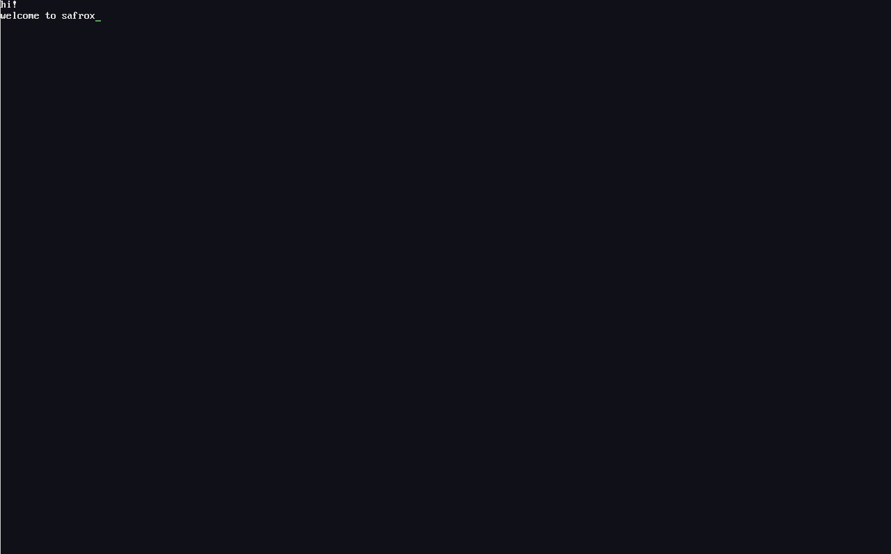

# Safrox

Safrox — a capability-based microkernel and operating system,
written in Rust.



Safrox is an x86-64 kernel that boots on QEMU through Limine. The
kernel manages memory, scheduling, and the capability system that
names everything else, and does nothing else. Device drivers,
including the one that puts those lines on the screen above, are
ordinary components in user space.

What makes it different is a straightforward application of
capability discipline: the kernel exposes no device by name, and
authority to a device is held as a capability, not inferred from
who you are. A keyboard driver that holds the IOPort for `0x60`
can talk to the i8042; a console that does not holds no way to
even refer to the port. When the keyboard component is forcibly
killed, the console keeps running on its own capabilities. Both
properties are tested, not asserted.

What works today is the path from a key on the host keyboard, into
`send-key` over QMP, through QEMU's i8042, through an IRQ 1 the
kernel routes to a user-space driver, through an IPC rendezvous,
into another component that draws glyphs read back out of the real
framebuffer. There is no filesystem, no network stack, no shell,
and only one CPU. The parts that work are solid; the list is
short on purpose.

## By the numbers

| Measured by | Count |
|---|---|
| Acceptance scenarios (all passing) | 72 |
| Architecture Decision Records | 56 |
| Commits (each one passes `make test`) | 27 |
| Rust source, kernel + user components | 55,025 lines |

Commands used to measure, respectively:

```
grep -cE '^    .[a-z0-9-]+.: Expectation' scripts/run.py
ls docs/adr/*.md | wc -l
git log --oneline | wc -l
find kernel/src abi/src roottask/src driver/src screen/src \
     keyboard/src console/src -name '*.rs' | xargs wc -l
```

## Build and run

Development is on WSL Ubuntu with a nightly Rust toolchain and
QEMU 8.x. The host side (Windows) is not required.

```
rustup target add x86_64-unknown-none
make test       # the 72 scenarios; takes a couple of minutes
make run        # boots into the keyboard/console scenario
```

`make test` ends with lines like:

```
[PASS] keyboard and console: exit status 33 (guest wrote 0x10 ...)
[PASS] the console scrolls: exit status 33 (...)
```

If anything fails it stops with the serial log named.

## Architecture

```
+--------------------------------------------------+
|  kernel  (ring 0)                                |
|    capability objects, IPC, scheduler            |
|    IRQ routing, memory, VSpace                   |
+-------------------+------------------------------+
                    | syscalls, capabilities only
+-------------------+------------------------------+
|  root task  (ring 3)                             |
|    builds every other component, hands           |
|    out capabilities, then stops                  |
+--------+----------+----------+---------+---------+
         |          |          |         |
     serial     screen     keyboard   console
    (IRQ 4,   (framebuf- (IRQ 1,     (frames,
     COM1)     fer dev   IOPort     IPC endpoint)
               untypeds)  0x60/0x64)
```

Everything below the root task is a separate binary with its own
address space. None of them can name the others' hardware; the
only thing they share is the Endpoint they were given.

## Known limits

- **Single CPU.** SMP is unimplemented; the I/O APIC's destination
  field is hard-coded to LAPIC 0 (hardware-todo.md item 7).
- **QEMU only.** Verified on QEMU 8.2's q35 machine. The I/O APIC
  routing uses the ISA defaults (edge, active-high); ACPI MADT
  Interrupt Source Overrides are not read (item 13). The scan code
  decoder depends on BIOS leaving i8042 translation enabled (item
  11). `docs/hardware-todo.md` has thirteen items like these.
- **No filesystem.** No persistent storage of any kind.
- **No network.**
- **No GPU** — the framebuffer is a linear writable surface Limine
  configures, not a real device driver.
- **No shell.** The keyboard→console path types into a running
  component; there is nothing to launch.

## Documentation

- [`docs/journal.md`](docs/journal.md) — the development log, one
  entry per milestone. 3000+ lines; what was tried, what failed,
  what was measured.
- [`docs/adr/`](docs/adr/) — 56 Architecture Decision Records,
  **written in Turkish**. Each one records a decision and
  everything it depended on. 023 is the test discipline (K1–K15).
  Translation into English is a separate task.
- [`docs/hardware-todo.md`](docs/hardware-todo.md) — the
  thirteen things that work on QEMU and have not been verified on
  real hardware.
- [`docs/`](docs/) also carries address-space, interrupt and IPC
  design notes.

## License

[MPL-2.0](LICENSE). File-level copyleft: changes to a Safrox file
stay under MPL; new files alongside do not have to. ADR 052 records
why this license was chosen.